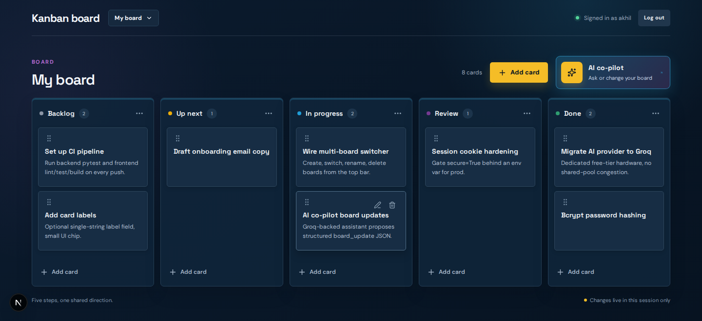
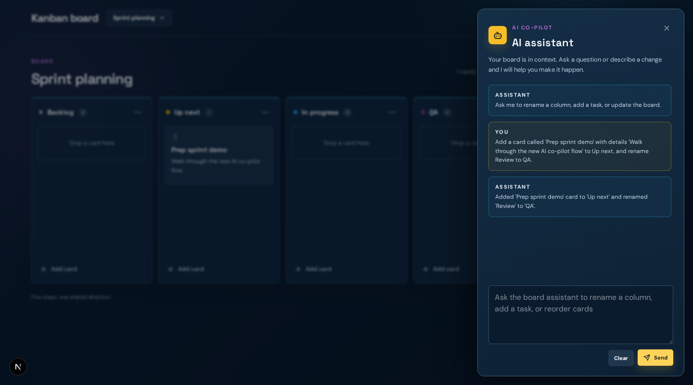
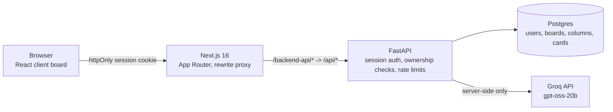

# Kanban Board

A full-stack, multi-user Kanban app: real accounts, private boards, drag-and-drop cards on desktop and phone, and an AI co-pilot that can read and edit the board. It is deliberately small in features and thorough in testing.

**Live app:** https://kanban-board-seven-lilac.vercel.app/

The backend runs on a free hosting plan that sleeps after 15 idle minutes. The first visit after that shows a "Waking up the server" screen for 30-50 seconds, then continues on its own.



## Contents

- [What it does](#what-it-does)
- [How it works](#how-it-works)
- [Tech stack](#tech-stack)
- [Quick start](#quick-start)
- [Testing](#testing)
- [Documentation](#documentation)

## What it does

- **Accounts.** Sign up, sign in, sign out and reset a password. Passwords are bcrypt-hashed. Sessions are server-side, carried by an httpOnly cookie.
- **Boards.** Each account has one or more private boards, each with five renameable columns. Create, rename, switch and delete boards from the top bar.
- **Cards.** Add, edit and delete cards, and drag them within and across columns with a mouse, a finger or the keyboard.
- **AI co-pilot.** Ask a question or describe a change, for example "Add a card called Prep sprint demo to Up next and rename Review to QA". Type "undo" to revert the AI's last change.
- **Phone layout.** Column chips jump between columns, the board snaps to whole columns when swiped, and the AI panel fits the visible screen.



## How it works



- **Every board query is scoped to its owner.** A board that belongs to someone else returns 404, the same as one that does not exist, so its existence is never revealed.
- **Edits appear at once and save in the background.** A failed save rolls the board back and offers Retry. Saves go out one at a time and only the newest state is kept, so an older response can never overwrite a newer edit.
- **The AI never writes to the board directly.** The backend requires the model to answer in a fixed JSON shape, merges its (possibly partial) update into the real board, and validates the result with the same rules as a normal save. A malformed reply, or one that claims a change it did not include, is retried once and then rejected.
- **The API key stays on the server.** The browser never sees `GROQ_API_KEY`. AI requests need a signed-in session and are limited per account, because one key serves every user.
- **Data outlives the server.** The database is a separate managed Postgres, so accounts and boards survive the backend redeploying or going to sleep.

More detail: [docs/architecture.md](docs/architecture.md).

## Tech stack

| Layer | Choices |
|---|---|
| Frontend | Next.js 16 (App Router), React 19, TypeScript, Tailwind CSS v4, dnd-kit |
| Backend | FastAPI, psycopg connection pool, bcrypt, uv |
| Database | Postgres 16 (Neon in production, Docker Compose locally) |
| AI | Groq (`openai/gpt-oss-20b`), called from the backend only |
| Testing | pytest, Vitest + Testing Library, Playwright |
| Hosting and CI | Vercel (frontend), Render (backend), Neon (database), GitHub Actions |

## Quick start

Needs Docker, Node.js and (for the backend tests) [uv](https://docs.astral.sh/uv/).

```bash
cp .env.example .env && chmod 600 .env      # optional: set GROQ_API_KEY to enable the AI (free, no card)
./scripts/start.sh                          # backend + Postgres via Docker Compose, http://127.0.0.1:8000
cd frontend && npm install && npm run dev   # http://localhost:3000
```

Sign up with any username and password. To run the backend without Docker, see [docs/deployment.md](docs/deployment.md#local-run).

## Testing

### At a glance

| Layer | Tool | What it proves | Size | In CI |
|---|---|---|---|---|
| Backend unit and integration | pytest, against a real Postgres (no database mocks) | auth, sessions, ownership, validation, the AI contract, rate limits, concurrency | 105 tests | yes |
| Frontend unit and component | Vitest + Testing Library | board operations, forms, the save queue, the wake-up screen, session expiry | 70 tests | yes |
| End-to-end | Playwright, real browsers against a real backend and database | whole user journeys, drag and drop, phone layout | 9 scenarios x 4 device profiles | no |
| Load | a script that simulates concurrent users | speed and data isolation with many people at once | 5 and 25 users | no |
| AI behavior | an eval against the real Groq model | the live model still follows the rules | 6 cases | no |
| Real device | manual checklist on a Galaxy S24 Ultra | what emulation cannot show | 7 checks | no |

GitHub Actions runs the backend suite (with a Postgres service container) and the frontend lint, type check, unit tests and build on every pull request. The end-to-end suite, load check and AI eval are run by hand before a release: they need browser binaries, a live backend and database, or paid-for model quota.

### Device coverage

| Device profile | Browser engine | Viewport (CSS px) | Input | Coverage |
|---|---|---|---|---|
| Desktop | Chromium | 1280 x 720 | mouse, keyboard | Playwright |
| iPhone 13 | WebKit (the Safari engine) | 390 x 664 | touch | Playwright emulation |
| Pixel 7 | Chromium | 412 x 839 | touch | Playwright emulation, real touch drag |
| Galaxy S24 Ultra | Chromium | 384 x 824, pixel ratio 3.75 | touch | Playwright emulation with real touch drag, plus manual checks on the real phone |

- Every scenario runs on every profile: 36 runs, of which 32 run and 4 are skipped by design.
- The touch drag test sends real touch input through Chromium's DevTools protocol, not synthetic JavaScript events, so the browser's own scroll and gesture handling is part of the test. That is where the original phone bug was.
- Playwright cannot script real touch input in WebKit, so touch drag is skipped on the iPhone profile. Touch drag on iOS is not covered by automation and has not yet been checked on a real iPhone.
- The Galaxy S24 Ultra is the narrowest of the three phones, so layout problems show there first.

End-to-end scenarios: drag within and across columns; the core card workflow; several boards kept separate; renaming and re-selecting a board; a narrow viewport; reaching every column and the AI text box on a phone; maximum-length text staying inside its box on a phone; desktop layout; sign-in required and logout.

### Edge and boundary cases

Each limit is tested at the boundary and one step past it.

| Field | Rule | Accepted | Rejected |
|---|---|---|---|
| Username | 3-32 characters: letters, digits, `-`, `_` | 3 and 32 | 2 and 33, spaces, other symbols |
| Password | 8-128 characters | 8 and 128 | 7 and 129 |
| Card title | 1-200 characters after trimming | 200 | 201, blank, whitespace only |
| Card details | up to 5,000 characters | 5,000 | 5,001 |
| Column name | 1-80 characters after trimming | 80 | 81, blank |
| Board name | 1-120 characters after trimming | 120 | 121, blank |
| Board structure | exactly 5 columns, unique ids, contiguous card positions | | 4 or 6 columns, duplicate ids, a gap in positions |
| Boards per account | at least 1 | | deleting the last board (409) |

Other cases covered by tests:

- **Security and isolation.** Another account's board returns 404 on read, save, rename, delete and AI chat. Requests without a session return 401. Login never says which field was wrong. An unknown username gets the same password-reset response as a known one.
- **Sessions and tokens.** Expired sessions are rejected. A reset token works once; expired and reused tokens fail. A password reset signs out every session of that account. A session that ends during use returns the user to sign-in with an explanation.
- **Hostile and unusual input.** HTML-looking and SQL-looking text is stored and shown as plain text. Non-Latin text is stored unchanged. A null character is rejected. A 200-character word wraps inside its card.
- **Concurrency.** Sixteen simultaneous saves of one board all succeed and leave a valid board. Two simultaneous deletes cannot remove an account's last board. A slow save for a board the user has switched away from does not overwrite the board on screen.
- **Failure handling.** A failed save rolls back and offers Retry. A database error returns a clean server error. A sleeping backend shows the wake-up screen, and an error with Try again after 90 seconds.
- **Rate limits.** Sign-up and login: 20 requests per minute per IP. AI: 10 requests per minute per account, not shared between accounts. The limit window expires correctly.

### Load test: concurrent users

`backend/scripts/load_check.py` simulates N people using the app at the same moment, each with their own account. Each one signs up, loads a board, saves it five times and reloads it. The script then checks that every user sees exactly their own cards and nobody else's.

| Users | Total time | Save p50 / p95 | Board load p95 | Data isolation |
|---|---|---|---|---|
| 5 | 1.2 s | 46 / 54 ms | 40 ms | every user saw only their own data |
| 25 | 3.5 s | 180 / 233 ms | 211 ms | every user saw only their own data |

The same 25-user run took 21 seconds before the backend moved from one global lock to a database connection pool. The numbers are from a development laptop with a local database; the deployed free-tier server is slower, and the load check has not been run against it.

### Testing the AI feature

A live language model is slow, costs quota and gives different answers each run, so it cannot gate a merge. The approach has two parts:

1. **Deterministic tests of the contract.** Every backend AI test replaces the Groq HTTP call with a fake reply and asserts on what the backend does with it: malformed JSON, a reply that claims a change but includes none, a card with the wrong field name, a partial update, an update naming a column that does not exist, a timeout, and a rate-limit response. These run in CI.
2. **A manual eval of the real model.** `backend/eval/ai_eval.py` sends six representative prompts to the live model (rename, add, remove, a pure question, a request to break the five-column rule, HTML-looking input) and checks the outcome. It is run after changing the system prompt or the model.

### Defects found by testing

| Defect | How it was found | Now guarded by |
|---|---|---|
| A card title of only spaces was saved as empty, after which the board could never be opened again (HTTP 500) | boundary probing of the API | backend tests for blank text on every text field |
| Dragging did nothing on Android: the browser treated the touch as a scroll | report from a real phone | a real-touch end-to-end test |
| Two saves in flight could land out of order, so an older state overwrote a newer edit | writing the touch drag test | unit tests of the save queue |
| The AI replied "added a card" with a card named by the wrong field; the save failed silently and the board rolled back | manual testing | a backend test and full validation of every card |
| On a Galaxy S24 Ultra the Done column seemed missing and the AI text box sat under the browser toolbar | manual test on the real phone | end-to-end tests at that phone's width, and the real-device checklist |
| A 201-character title showed on the board, then every save failed | boundary testing of the UI | input limits and a component test |
| A phone keyboard capitalised the first letter of a case-sensitive username, so sign-in failed | review of the sign-in form on a phone | a component test |
| A 200-character word spilled out of its card | visual check at phone width | an end-to-end layout test |
| Switching boards during a save overwrote the new board with the old one | reproduced as a failing test first | the same test, kept as a regression guard |

### Run the tests

```bash
docker compose up -d postgres --wait          # backend tests need Postgres on localhost:5432

cd backend
uv run pytest -q                              # uses a separate kanban_test database

cd ../frontend
npm run lint && npx tsc --noEmit
npm run test -- --run
npm run build
npm run test:e2e                              # all four device profiles
npx playwright test --project=galaxy-s24-ultra

cd ../backend
uv run python scripts/load_check.py --users 25   # needs a running backend
uv run python eval/ai_eval.py                    # needs a running backend and GROQ_API_KEY
```

The full test reference, including known limitations and the real-device checklist, is in [docs/testing.md](docs/testing.md).

## Documentation

- [docs/testing.md](docs/testing.md): test strategy, device matrix, edge cases, load test, real-device checklist
- [docs/architecture.md](docs/architecture.md): backend, frontend and AI co-pilot in detail
- [docs/deployment.md](docs/deployment.md): hosting, environment variables, limits
- [docs/database-schema.md](docs/database-schema.md): tables and rules
- [docs/PLAN.md](docs/PLAN.md): the build log, part by part, with decisions
- [AGENTS.md](AGENTS.md): product requirements and coding standards
