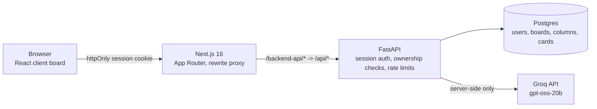

# Architecture

How the app is put together. For setup and commands see the [README](../README.md); for hosting see [deployment.md](deployment.md); for tests see [testing.md](testing.md); for tables see [database-schema.md](database-schema.md).

## Overview

- **Frontend** (`frontend/`): Next.js App Router, TypeScript, a client-only board. The browser only ever talks to its own origin; Next.js rewrites `/backend-api/*` to the backend's `/api/*` on the server (`next.config.ts`, target set by `KANBAN_BACKEND_URL`). So the session cookie is same-origin and needs no CORS setup.
- **Backend** (`backend/`): FastAPI. Sessions are server-side, tracked by an httpOnly `kanban_session` cookie. All data is in Postgres.
- **AI co-pilot**: the backend calls Groq. The browser never sees `GROQ_API_KEY`.

## Backend

### Module layout

| File | Holds |
|---|---|
| `app/main.py` | wiring only: lifespan (opens the repository), routers, error handlers, `/health`, `/api/health`, the smoke page |
| `app/routers/auth.py`, `boards.py`, `ai.py` | the endpoints |
| `app/deps.py` | `get_repository` (reads `app.state.repository`), `get_current_user` |
| `app/rate_limit.py` | the one `RateLimiter` class and both limiter instances |
| `app/ai_service.py` | system prompt, the Groq call, reply parsing, `merge_board_update` |
| `app/attachments.py` | file type detection and text extraction for AI attachments |
| `app/repository.py` | all database access (`KanbanRepository`) |
| `app/models.py` | the Pydantic request and response shapes, and every length limit |
| `scripts/load_check.py` | concurrent multi-user check, see [testing.md](testing.md) |
| `eval/ai_eval.py` | manual check of the real model's behavior |

### API

Auth (`/api/auth`):

| Route | Behavior |
|---|---|
| `POST /signup` | creates the user and their first board, sets the session cookie; 409 on a duplicate username |
| `POST /login` | 401 on any bad credential, without saying which field was wrong |
| `POST /logout` | deletes the session |
| `GET /me` | the signed-in user; 401 without a valid session |
| `POST /forgot-password` | always 200; `reset_token` is `null` for an unknown username |
| `POST /reset-password` | 400 on an invalid, expired or used token; on success signs out all of that user's sessions |

There is no email provider. The reset token is returned in the response and the frontend shows the reset link on screen.

Boards (`/api/boards`), all requiring a session:

| Route | Behavior |
|---|---|
| `GET /api/boards` | the user's boards as id and name |
| `POST /api/boards` | a new board with the five default columns |
| `GET /api/boards/{id}` | one board with its columns and cards |
| `PUT /api/boards/{id}` | replaces the whole board (name, columns, cards) |
| `PATCH /api/boards/{id}` | renames it |
| `DELETE /api/boards/{id}` | 204; 409 if it is the user's only board |

A board id that belongs to someone else returns 404, the same as one that does not exist, so its existence is never revealed. There is no `user_id` in any URL: the session decides whose boards are in scope.

AI (`/api/ai`), requiring a session: `GET /check` is a cheap live connectivity probe; `POST /attachments` and `POST /chat` are described below.

Other: `GET /api/health` answers without touching the database. The frontend polls it while the backend wakes, so it must stay that way.

Repository errors map to HTTP in `main.py`: board not found 404, last board 409, database unreachable or broken 500.

### Data and concurrency

- Every board-scoped repository method takes `(user_id, board_id)` and checks `WHERE id = %s AND owner_id = %s`.
- `save_board` replaces all of a board's columns and cards on every PUT (delete, then insert), so the frontend always sends the complete board, not a diff. Its first statement updates the board row, which makes simultaneous saves of one board queue up instead of colliding.
- `delete_board` locks the account's board rows first, so two simultaneous deletes cannot remove the last board.
- Every operation borrows a connection from a `psycopg_pool.ConnectionPool` (1 to 10 connections, health-checked on checkout because Neon drops idle connections) and runs in one transaction. Postgres handles concurrency; there is no application lock. Nothing else in the code should open its own connection.
- Pydantic validation runs on the way in and again when a board is read back.
- Text is trimmed before its length is checked, so a whitespace-only title is rejected instead of being stored empty. A null character is rejected, because Postgres text cannot hold one.
- Passwords are bcrypt hashes. Session and reset tokens are stored only as SHA-256 hashes. Sessions last 7 days, reset tokens 30 minutes.

### Rate limits

Both limiters are in memory (`rate_limit.py`), which is enough for the single backend instance, and they sweep idle keys every 500 hits so memory stays bounded.

- **Auth**: sign-up, login, forgot-password and reset-password share 20 requests per minute per client IP (`KANBAN_AUTH_RATE_LIMIT` overrides it). `/me` and `/logout` are not limited.
- **AI**: 10 requests per minute per account, through the `ai_user` dependency.

The Dockerfile runs uvicorn with `--proxy-headers --forwarded-allow-ips "*"`, so `request.client.host` is the visitor's IP from `X-Forwarded-For` rather than the proxy's. Without that, every visitor would share one auth bucket. Accepted trade-off: someone calling the backend URL directly can forge that header to dodge the per-IP limit; bcrypt cost and the per-account AI limit still apply.

## Frontend

### Start-up and session

`app/page.tsx` runs, in order:

1. `waitForBackend()` polls `GET /api/health` until it gets anything below 500. That first request is also what wakes a sleeping backend. If it takes longer than 2 seconds, `components/wake-up-screen.tsx` shows "Waking up the server" with a progress bar; after 90 seconds it shows an error with Try again. A warm backend never shows it.
2. `getCurrentUser()` (`GET /api/auth/me`) decides between the board and the sign-in screen. There is no client-side "signed in" flag.
3. `listBoards()`, then `fetchBoard(activeBoardId)` whenever the active board changes. The active board is plain client state and defaults to the first board.

`<Board>` is rendered with `key={username}`, so React remounts it on every login, logout and sign-up. Without that, client-only state such as the AI chat history would stay visible under the next account.

A 401 from any request outside `/auth/*` means the session ended (expired, or a password reset elsewhere). `lib/api.ts` reports it through `onSessionExpired`, and `page.tsx` returns to sign-in with a notice.

### Saving

`page.tsx` is the only place that calls the board API. `Board` is a controlled component: every change calls `onColumnsChange(next, previous)`.

- `persistBoard` updates the screen at once and queues the full board state.
- `flushSaves` sends one PUT at a time. While one is in flight only the newest requested state is kept. Each PUT replaces the whole board, so two in flight could land out of order and the older would overwrite the newer; sending one at a time prevents that.
- A response is applied only if it is still for the active board and no newer edit was made since it was sent. A failed save rolls back to `previous` and shows a Retry banner.
- While a save is pending, a `beforeunload` listener asks the browser to warn before leaving.
- The board name is mirrored in `boardNameRef`, because an AI update renames the board and saves in the same tick, before React re-renders.

### Shapes

`lib/types.ts` (`Card`, `Column`, no `position`) is the UI shape. `lib/api.ts` (`ApiCard`, `ApiColumn`, with `position`) is the wire shape. `toColumns()` converts wire to UI (sorts by position, drops it); `toApiColumns()` converts back (position from array order). Array order is the source of truth in the frontend; explicit positions are the source of truth in the API and the database.

### Board UI

- `components/board.tsx` holds UI state (dialogs, drag overlay) and the dnd-kit context. Every mutation is a pure function in `lib/board-ops.ts` (`moveCard`, `addCard`, `updateCard`, `deleteCard`, `renameColumn`).
- New card ids are `card-${crypto.randomUUID()}`.
- Drag uses separate `MouseSensor` and `TouchSensor` (150 ms press-and-hold) plus a keyboard sensor. The drag handle has `touch-action: none`; without it the browser treats the touch as a scroll and cancels the drag. dnd-kit's sortable `attributes` sit on the handle, not the card, so the card's buttons are not nested inside another interactive element.
- Below 1280 px wide (five columns need about 1270 px) the board scrolls sideways with scroll snapping (off during a drag, so it does not fight the drag auto-scroll), and `components/column-nav.tsx` shows a chip per column that jumps to it.
- Dialogs (`board-dialogs.tsx`) close on Escape and return focus to the element that opened them. Their inputs carry the same `maxLength` as the backend limits.
- `components/board-switcher.tsx` lists, creates, renames and deletes boards. Delete is hidden when one board remains.

## AI co-pilot

`components/ai-assistant.tsx` sends the current board (wire shape), the prompt and the last 8 chat messages to `POST /api/ai/chat`. The panel stays mounted while closed, so the conversation survives closing it. On phones it is sized with `100dvh`, so a browser's bottom toolbar cannot cover the text box.

On the backend (`routers/ai.py`, `ai_service.py`):

1. The request's `board.id` must be a board the session user owns (404 otherwise). The client's copy of the board is used as context, because it may include edits still being saved. It is sent to Groq as compact JSON without `owner_id`.
2. The model must reply with JSON `{assistant_message, board_update?}`. `board_update` may be partial: only the columns it changed.
3. `merge_board_update` folds it into the request's board. Columns stay fixed; a listed column's `cards` replaces that column's cards; a card placed somewhere is removed from its old column; details the model omitted are kept. The result is validated with the same `BoardUpdate` model as a normal save, so the frontend always receives a complete, valid board.
4. `describe_changes` compares the request's board with the merged one and returns the change list (`changes: [{kind, text}]`: board or column renamed, card added, removed, moved, renamed, details changed, cards reordered), naming cards by title and columns by name. The list comes from code, not from the model. An update that changes nothing is dropped.
5. Malformed JSON, a failed merge, or a reply that claims a change (matches `CLAIMED_CHANGE_PATTERN`) while making none counts as a failed attempt. There is one retry, then a 502.
6. Card ids are internal. A reply that mentions one is retried once; if the retry fails or also mentions one, the server shows each id as the card's quoted title (`replace_card_ids`), so an id never reaches the user.
7. The prompt and the reply are logged to `ai_chat_messages` for analysis in SQL. They are not exposed through any endpoint.

The chat call uses `reasoning_effort: "medium"`. With `"low"` the model often missed some of the cards in requests such as "remove all cards with number 2" (see PLAN.md Part 22).

The panel shows the change list under the reply. A returned `board_update` is applied like any local edit, through `onColumnsChange`, so it takes the same optimistic save path. An update that removes a card is the exception: the panel shows its own text and the list instead of the model's words, and nothing changes until Apply. Send is blocked until then, and Apply is refused if the board changed meanwhile, because the update replaces the whole board. The chat history sent to the model includes each change list and whether it was applied.

**Attachments.** `POST /api/ai/attachments` takes one multipart `file` (4 MB at most, because the hosting proxy caps request bodies at 4.5 MB; an over-size `Content-Length` is refused before the body is read). The type is decided from the extension plus the file's leading bytes, never the browser's content type. PDF (`pypdf`), DOCX, XLSX, PPTX and text files are parsed in the threadpool; Office files are checked for a 50 MB unpacked size first. PNG, JPG and WEBP go once to `GROQ_VISION_MODEL`, which turns the image into text. The route returns `{name, text, truncated}` and stores nothing.

The browser holds that text and sends up to 3 `attachments` with the next chat message only; later turns carry just the conversation text, to stay inside the shared token budget. The chat route splits `AI_ATTACHMENT_MAX_CHARS` (10,000) between the files, wraps each as a JSON string in `<attachment>` tags, and orders the prompt as system, history, attachments, board, then the user's request last. That order matters: in testing, delimiters alone did not stop the model following an instruction planted in a file; putting the user's request last did. Only attachment names are logged. `max_tokens` is 2500 with attachments and 1500 without.

In the panel, files come from the Attach button (on a phone the system picker reaches the camera and cloud drives) or drag-and-drop, and show as removable chips. `lib/api.ts` leaves `Content-Type` unset for `FormData` so the browser sets the multipart boundary.

**Undo.** Before applying an update, the panel keeps a snapshot of the board. A prompt containing the word "undo" restores that snapshot locally, with no Groq request, because the model is never shown earlier board states and cannot rebuild one.

**Shared quota.** One Groq key serves every user: 8,000 tokens per minute and 1,000 requests per day on the free tier. Every request carries a `max_tokens` cap. When Groq rate-limits, the backend answers 429 with "The AI is busy right now..." and a `Retry-After` header, and the panel shows that message.
